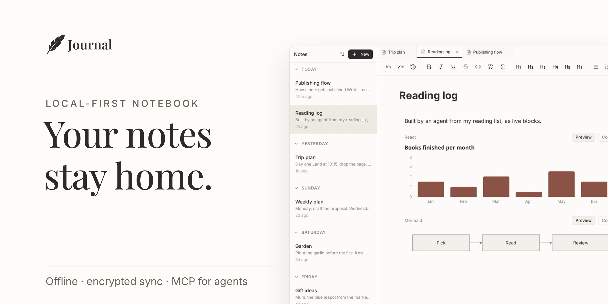

<picture>
  <source media="(prefers-color-scheme: dark)" srcset="brand/png/readme-banner-dark.png">
  
</picture>

# Journal

Journal is a local-first notebook on your own [Homebase](https://homebase.id) identity. Your notes are in a database in your browser (PGlite), so Journal works offline. It syncs them, encrypted, to your identity. You can install it as an app (PWA).

Open it at [journal.cloudx.run](https://journal.cloudx.run). The website has more detail.

> [!NOTE]
> To try Journal, sign in as `john.doe.demo.rocks` with the password `a`. Other people use this demo identity, so do not keep private notes in it.

## Features

- An editor with Markdown shortcuts, math, code, callouts, toggles, tables, task lists, link previews and image galleries.
- Live blocks: Mermaid, SVG, HTML and React that run in the note.
- Folders (one level), tags and full-text search.
- Sharing with other Homebase identities and circles, and public pages with a link to copy.
- Version history on each device.
- Import from Markdown, Notion or Obsidian. Export to Markdown or PDF.
- An optional AI assistant that runs on your device with WebLLM, in desktop browsers.
- An MCP server that lets AI agents read and write the folders you grant.

## AI agents

Claude Code, Claude Desktop, Cursor and Codex CLI connect through the Journal MCP server. To add it to Claude Code, run:

```
/plugin marketplace add 2002Bishwajeet/journal
/plugin install journal@journal
/journal:login you.dotyou.cloud
```

Then grant folders in **Settings → Agent access**. The [agents page](https://journal.cloudx.run/landing/agents) and [mcp/README.md](mcp/README.md) cover the other clients and all the tools.

## Develop

You need Node 22 or newer. You also need a GitHub token with the `read:packages` scope, because `@homebase-id/js-lib` is on GitHub Packages.

1. Clone the repository.
2. Create `.npmrc` in the project root with these two lines. Do not commit it.

   ```ini
   @homebase-id:registry=https://npm.pkg.github.com
   //npm.pkg.github.com/:_authToken=${GH_TOKEN}
   ```

3. Set `GH_TOKEN` to your token, then run `npm ci`.
4. Run `npm run dev` and open https://dev.dotyou.cloud:5173. This name points to `127.0.0.1`, and its certificate is in the repository.

```bash
npm run build   # type check and production build
npm run lint    # ESLint
npm run test    # Vitest unit tests
npm run e2e     # Playwright tests on 127.0.0.1, never a real identity
```

[AGENTS.md](AGENTS.md) describes the architecture, project structure, conventions and testing policy. [e2e/README.md](e2e/README.md) describes the e2e tests.

## Licence

[AGPL-3.0](LICENSE). Release notes are in [RELEASE_NOTES.md](RELEASE_NOTES.md).
