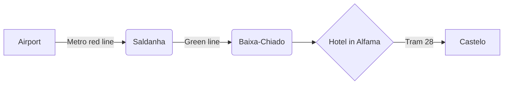

> [!tip]
> Buy a Viva Viagem card at the airport. Tram 28 fills up by 10, so ride it early.

## Plan

| Day | Morning | Evening |
|---|---|---|
| Fri | Alfama walk, Miradouro de Santa Luzia | Fado in Mouraria |
| Sat | Belém, pastéis at the source | Sunset at LX Factory |
| Sun | Sintra by train | Dinner at Cervejaria Ramiro |

## Packing

- [x] Passport and boarding passes
- [x] Walking shoes
- [x] Light rain jacket
- [ ] Power adapter (type F)
- [ ] Offline map of Sintra

