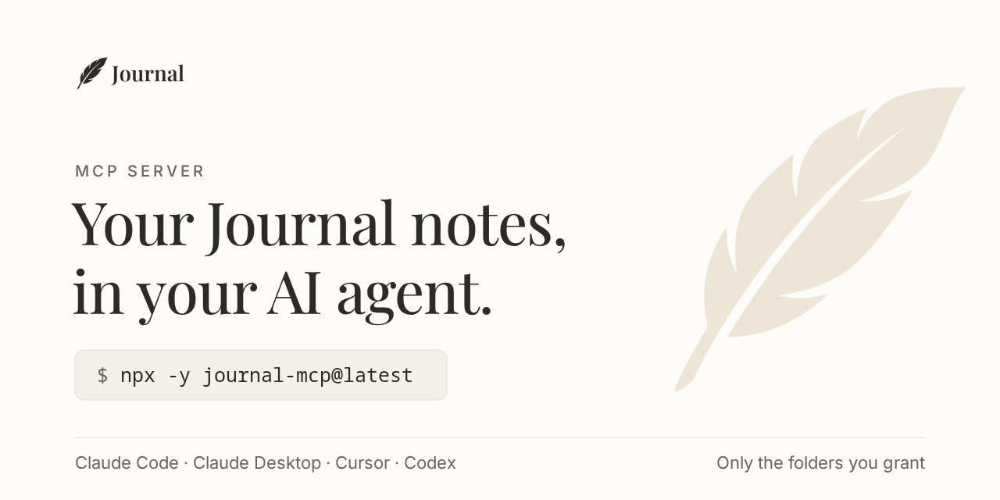

<!-- The npm package's README. `npm run mcp:pack` fills in the tool list and writes it to mcp/package/README.md (mcp/npmReadme.ts). -->



# journal-mcp

The MCP server for [Journal](https://journal.cloudx.run), the local-first notebook on your
[Homebase](https://homebase.id) identity. Your AI agent can read, search, create and edit
your notes, but only those in the folders you grant it in **Journal → Settings → Agent access**.
Until you grant a folder, the agent sees nothing.

## Install

The server runs through `npx`, so you need Node 20 or newer and nothing else.

**Claude Code** (plugin, which also adds `/journal:login`):

```
/plugin marketplace add 2002Bishwajeet/journal
/plugin install journal@journal
```

Or add the server by hand: `claude mcp add journal -- npx -y journal-mcp@latest`

**Claude Desktop** (`claude_desktop_config.json`) and **Cursor** (`~/.cursor/mcp.json`):

```json
{ "mcpServers": { "journal": { "command": "npx", "args": ["-y", "journal-mcp@latest"] } } }
```

**Codex CLI** (`~/.codex/config.toml`):

```toml
[mcp_servers.journal]
command = "npx"
args = ["-y", "journal-mcp@latest"]
```

## Log in

Sign in once per computer with your Homebase identity (in Claude Code: `/journal:login you.dotyou.cloud`):

```bash
npx -y journal-mcp@latest login you.dotyou.cloud
```

Your browser opens your Homebase owner console. Approve **Journal MCP**: it asks for Read +
write on your notes drive and nothing else. Then restart your MCP client (in Claude Code,
`/mcp` → reconnect `journal`). On a machine with no browser, such as over SSH, add
`--no-browser`: it prints a link to open on any device and asks for the code Journal shows.

The credentials go to your OS keychain. Where no keychain is available (headless Linux),
they go to a `0600` file at `~/.config/journal-mcp/credentials.json`. `journal-mcp logout`
removes them. To revoke access from anywhere, remove **Journal MCP** under **Apps** in your
owner console.

## Tools

<!-- tools -->

## Updates

Each release is published here, so a client that runs `journal-mcp@latest` picks up the new
version the next time it starts the server: restart your MCP client. If you added the server
with a pinned `…/journal-mcp-<version>.tgz` URL, switch it to `journal-mcp@latest`. A
pinned URL never updates.

Once a day at most, in the background, the server asks the npm registry for the latest
version. The request is anonymous, has a 3-second timeout and sends nothing about you or your
notes. When a newer version is out, the server tells your agent on the next start, and the
agent can pass that on to you. Offline, the server says nothing. To turn the check off, set
`JOURNAL_MCP_NO_UPDATE_CHECK=1`.

## Links

- [Journal](https://journal.cloudx.run), the app
- [Setup guide for agents](https://journal.cloudx.run/landing/agents)
- [Source](https://github.com/2002Bishwajeet/journal/tree/main/mcp) and [issues](https://github.com/2002Bishwajeet/journal/issues)

Licensed under AGPL-3.0.
